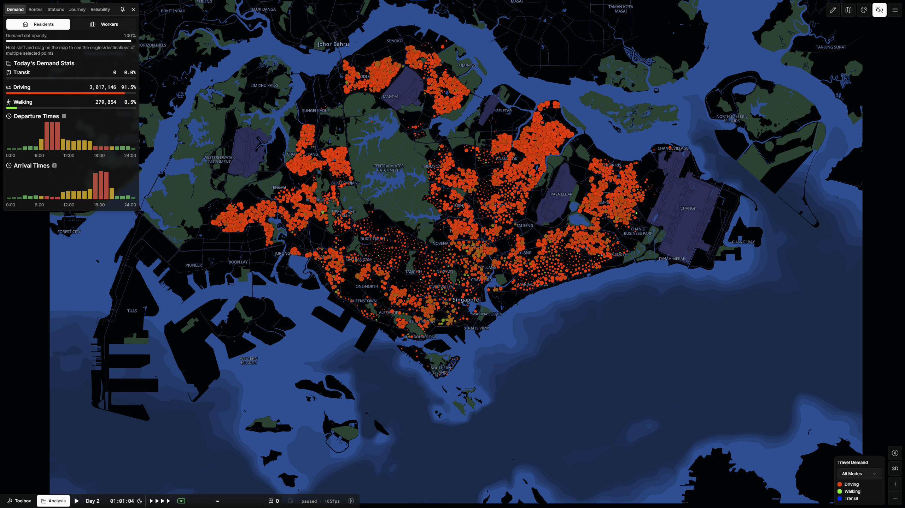
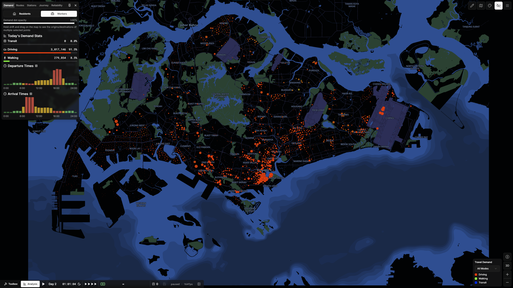

# Subway Builder Singapore Map

Brand-new map of Singapore, built on employed residence and workplace data from the 2025 General Household Survey, available at the subzone and planning area administrative levels, distributed onto Overture buildings with classifications guided by Singapore Masterplan zoning. The map is built using a modified version of Depot.

**Modelled demand**:

- **Working: 3,013,150**
  - The actual allocated employment population is different from the original number due to rounding steps during the distribution process.
  - This includes pre-distributed _special workforce demand_:
    - Government offices
    - Military bases
    - Hospitals
- **Non-working special: 283,850**
  - Airports: 63,400
  - Higher Education (Universities, Technical Colleges): 220,450
- **Total: 3,297,000**

<table>
  <tr>
    <td><strong>City Code</strong></td>
    <td><code>SG</code></td>
  </tr>
</table>

For those who want to convert saves from the old `SIN` map, use the [city code changer](https://github.com/Subway-Builder-Modded/city-code-changer).

  
  

## Statistics

<table style="width: auto">
  <tr><td><strong>Demand Points</strong></td><td align="right">4286</td></tr>
  <tr><td><strong>Populations</strong></td><td align="right">22,230</td></tr>
  <tr><td><strong>Median Point Size</strong></td><td align="right">1000</td></tr>
  <tr><td><strong>Mean Point Size</strong></td><td align="right">1538.5</td></tr>
  <tr><td><strong>Population Sizes</strong></td><td align="right">50, 200</td></tr>
  <tr><td><strong>Median Commute Distance (km)</strong></td><td align="right">9.81</td></tr>
  <tr><td><strong>Mean Commute Distance (km)</strong></td><td align="right">10.65</td></tr>
  <!-- <tr><td><strong>Median Commute Time (min)</strong></td><td align="right">14.7</td></tr>
  <tr><td><strong>Mean Commute Time (min)</strong></td><td align="right">16.0</td></tr> -->
</table>

## Methodology

_Note: there are two concepts of residence that are discussed. Legal residence concerns only total population numbers and is discussed in its own section. Otherwise, residents/residence refers to where a person lives._

The relevant statistics are available at different administrative units:

<table>
  <tr>
    <td><strong>Planning region</strong></td>
    <td>There are 5 regions in Singapore. Median size: 136.41 km²</td>
  </tr>
  <tr>
    <td><strong>Planning area</strong></td>
    <td>There are 55 planning areas in Singapore. Planning areas have about 50,000 to 250,000 residents. Median size: 10.60 km²</td>
  </tr>
  <tr>
    <td><strong>Subzone</strong></td>
    <td>There are 332 subzones in Singapore. The average subzone has around 10,000 to 30,000 residents, but the largest has >100,000. Median size: 1.19 km²</td>
  </tr>
</table>

The map's population data is grounded on 3 main datasets, all from the 2025 General Household Survey:

- Resident population by **subzone** of residence.
- Employed residents by **planning area** of residence.
- Employed workers by **planning area of workplace**, broken out by **planning region of residence**.

Population statistics are final extrapolated to final working-population totals (including foreign workforce and excluding invalid resident employment). Employed residence counts are pushed down to the **subzone** level by splitting a planning area's employed residents proportionally to subzones based the subzone's number of residents.

Buildings are obtained from Overture Maps and then filtered for demand-relevant buildings. Building types are coarsely classified based on OSM building types (via Overture) and [Singapore's Masterplan zoning](https://eservice.ura.gov.sg/maps/?service=MP), to: residential low/med/high, commercial, office, industrial low/med/high. Floorspace is estimated using a mix of building footprint + height, as well as the plot's max allowed floorspace serving as an upper bound. Residence and workplace statistics are then distributed down to these buildings, weighted by estimated floorspace and a set of manual coefficients. Special workforce demand is first injected before per-building distribution, with their workforce counts subtracted from subzonal totals to prevent double counting.

Per-building demand points are then aggregated with a minimum 200 m spacing. Aggregated demand points with less than 50 people are merged into nearby points. Commute flows are assigned using a gravity model constrained by the O/D matrix for (workplace planning area ⟷ residence planning region).

Special non-workforce demand is then finally added onto the existing demand data. Non-university/airport points are merged with existing points if necessary.

### Building Processing

TBC

### Population Distribution

TBC

Pops have sizes of 50 or 200 people. The majority are 200 to preserve performance, with size-50 pops only used to better model demand for less-dense areas.

### Map Creation

The Map is created using a [personal fork](https://github.com/Zeepheru/subwaybuilder-depot) of the Subway Builder map creation tool [Depot](https://github.com/Subway-Builder-Modded/depot). A few custom visual tweaks are made: removing canals/drains, and resolving water/park overlaps with university/retail zones.

Map buildings are notionally from Overture Maps, but ML building quality in Singapore is kinda meh and crucially, picks up way too many false positives, while OSM coverage in Singapore is good enough that the vast majority of rendered buildings after filtering end up being from OSM anyway. MRT stations and depots are all removed.

## Data

### Core Population Data

2025 General Household Survey

- Resident population by **subzone** of residence: [Resident Population by Planning Area/Subzone of Residence, Age Group and Floor Area of Residence (General Household Survey 2025)](https://tablebuilder.singstat.gov.sg/table/CT/C020126)
- Employed residents by **planning area** of residence: [Residents by Planning Area of Residence (General Household Survey 2025)](https://tablebuilder.singstat.gov.sg/table/CT/C020138)
- Employed workers by **planning area of workplace**, broken out by **planning region of residence**: [Employed Residents Aged 15 Years and Over](https://tablebuilder.singstat.gov.sg/table/CT/C020155)

<strong>Calculation of 3,013,150 Working Population</strong>

All geographic and census statistics concern only **resident** workers (citzens and permanent). Singapore relies heavily on non-resident foreign labour, with about 1.6 non-resident workers to 2.5 resident workers [1].

871,000 non-resident workers:

- Start with the total non-resident population of 1.91 million (2025), which includes working and non-working non-residents [2]
- Non-resident pass types [3]:
  - Employment Pass 11%, S-Pass 9% - general employment passes, _all included_
  - Work Permit 44%
    - Non-CMP (Construction, Marine (shipyard), Process) 21%
    - CMP 23%
      - Construction-sector migrant workers typically stay on dormitories near construction sites and/or are ferried by contractor transport, and so are _not included_ the home-workplace commuter pool. TWC (a local NGO) estimate the share of CMP being construction workers to be 79% [4], though this does vary wildly based on current construction projects.
  - Migrant domestic workers 16% - _not included_
  - Remainder: long term visit pass, dependent's pass, student's pass - all assumed non-working, _not included_
- All in all this leaves 871,000 relevant non-resident workers that also have to be distributed

150,000 daily Malaysia → Singapore commuters:

- Surface-level sources (Wikipedia, news articles) report 300,000 to 450,000 crossings, at the larger of the two land-border crossings, or the sum of both
- This however counts crossings rather than individual commuters.
  - [2017, Straits Times](https://www.straitstimes.com/world/malaysians-returning-to-singapore-for-work-as-border-controls-ease) reported ~100,000 Causeway-crossing commuters/day.
  - A key 2017 ISEAS source explicitly mentions an estimate of 120,000 Malaysian workers commuting daily, against 400,000 daily average crossings [5].
  - The most recent 2025 ICA Annual Report recorded an average of 510,000 daily land border crossings (245 million checkpoint crossings, 76% via land checkpoints) [6]. Combining this updated figure with the 2017 estimate's ratio produces a current figure of 150,000 daily commuters.
- As these are non-resident workers that don't live in Singapore, and **cross-border demand is not meant to be modelled** (for now), they are subtracted from the total.

A final total of 2,379,300 **resident workers** is derived from the dataset for employed residents by planning area. 81,200 who work-from-home are subtracted. Adding 871,000 non-resident workers and subtracting 150,000 daily Malaysia → Singapore commuters, and then after produces a final total of 3,019,060. But after some rounding during the aggregation and merging processes, the **final modelled workforce population is 3,013,150**.

The employed resident statistics are then extrapolated up to this final figure, to include the added non-residents.

Sources:

1. <https://stats.mom.gov.sg/Pages/employment-Summary-Table.aspx>
2. <https://www.mom.gov.sg/foreign-workforce-numbers>
3. [data.gov.sg | Share Of Non-Resident Population By Pass Types](https://data.gov.sg/datasets/d_94fd56bdb981f0f966cb487d8247bf1a/view)
4. [twc2.org.sg | Foreign workforce numbers, 2022](https://twc2.org.sg/2023/06/05/foreign-workforce-numbers-2022/)
5. [ISEAS The 2017 Johor Survey : Selected Findings](https://www.iseas.edu.sg/wp-content/uploads/pdfs/TRS20_17.pdf)
6. [ICA Annual Statistics Report 2025](https://www.ica.gov.sg/news-and-publications/statistics)

### Special Demand (workforce)

Special workforce demand describes large, instutitional, concentrations of workplaces that are modelled separately from general employment distribution. These seek to model these specific workplace concentrations more accurately than could be done using the main distribution methods. _It's easier to just ignore hospitals rather than try and come up with yet another heuristic distribution coefficient._

For some of them, exact data can be obtained publicly; but for others, estimations have to be done, just that the types of estimations are specific to the types of demand at play, and start from much more granular workplace totals.

#### Government

Government ministry workplace counts are taken from the number of employees on each ministry's payroll (from [Singapore Budget Revenue and Expenditure Estimates, FY2025/26](https://www.singaporebudget.gov.sg/revenue-and-expenditure)).

Not all government ministries are included. Those _not included_ are:

- Those with <50 payroll employees.
- [Statutory boards](https://en.wikipedia.org/wiki/Statutory_boards_of_the_Government_of_Singapore), which are another key source of concentrated government employment but do not have reliable public data.
- Ministries without a centralised location:
  - Ministry of Education - workforce breakdown is especially muddied with the inclusion of teaching staff.
  - Prime Minister's Office

#### Hospitals

This is modelled for Singapore's 20 acute hospitals, 1 psychiatric hospital, and 10 community hospitals. It excludes polyclinics, private clinics, and other care facilities.

While official public data shows the size of the the [overall healthcare workforce](https://www.moh.gov.sg/others/resources-and-statistics/health-manpower/), these figures are not used because data for clinics and especially other care facilities is very incomplete, so the estimations given were grossly inaccurate.

Employment figures are hence used for the hospitals/healthcare organisations that report them: All SingHealth hospitals, NHG total, NUH, St Luke's hospital. A combination of bed count (much more consistently reported) and hospital building floorspace (Overture) is then used to predict employment counts for all remaining hospitals using linear regression. IMH's staff numbers are set separately, estimated from a [source from 2015](<https://web.archive.org/web/20260121131415/https://www.moh.gov.sg/newsroom/institute-of-mental-health-(imh)/>), since it has a large number of beds relative to staff and would receive a disproportionately high workforce count.

The individual sources used are in the [Wikipedia List of Hospitals in Singapore](https://en.wikipedia.org/wiki/List_of_hospitals_in_Singapore), I updated them while doing research for making this map.

Hospital **visitation demand** is **not currently modelled**.

#### Military

Military workforce is estimated through a very simple proxy, using the [Wikipedia List of Singapore Armed Forces Bases](https://en.wikipedia.org/wiki/List_of_Singapore_Armed_Forces_bases). The number of military units on each base are the base's distribution weights. Each of the SAF's branches (Army, Navy, Air Force) then have their personnel numbers (active + 1/6 reserve) distributed to bases based on those weights.

### Special Demand (non-workforce)

Non-working demand that is injected after the main population distribution is completed.

#### Hotels

Main source: [data.gov.sg | Hotel Licensing Board Hotel dataset](https://data.gov.sg/datasets/d_654e22f14e5bb817423f0e0c9ac4f632/view), includes coordinates and room counts.

Hotels are added on as additional residential demand points for certain types of special demand, weighted using room counts.

Currently only serves as origin demand for airports, will be used for tourist attractions in the future.

#### Airports

The two commercial airports in Singapore are modelled:

<!-- <table>
  <tr>
    <td>Singapore Changi Airport (SIN/WSSS)</td>
    <td>63,000</td>
  </tr>
  <tr>
    <td>Seletar Airport (XSP/WSSL)</td>
    <td>400</td>
  </tr>
</table> -->

- Singapore Changi Airport (SIN/WSSS)
  - The number of transit passengers at SIN are not specified clearly anywhere, with the only sources reporting "about 30%" [1] or "around a third" [2].
  - Actual entry/exit passengers are hence estimated at 70M \* 2/3 / 2 = 23M yearly, or 63k daily.
  - SIN's passengers are then distributed onto the 4 individual terminals proportionately based on each terminal's passenger handling capacities: 24, 28, 22, and 16 million respectively.
- Seletar Airport (XSP/WSSL)
  - As of 2025, XSP's scheduled commercial passenger flights consist of 6 R/T Firefly flights, using ATR 72 aircraft [3]. With a capacity of 72 passengers per aircraft, this equates to a maximum of 864 arrivals and departures per day. This demand point is set to 400.

Airport demand is split between hotels and existing residential points. 13.8 million international visitors arrived by air in 2025 (excluding transit and transfer passengers) [4]. From SIN's 23M annual non-transit/transfer passengers, this equates to ~60%. Making a simplistic assumption that all international visitors stay at hotels

Sources:

1. [CAG LinkedIn Post](https://www.linkedin.com/posts/changiairportgroup_a-significant-proportion-about-30-of-activity-7454832148924198913-X3jO)
2. [CAG Blogpost Apr 2026](https://www.changiairport.com/en/corporate/our-media-hub/publications/changi-journeys/2026/changi-transit-experience.html)
3. [Seletar Airport | Firefly Schedules](https://web.archive.org/web/20250715193726/https://www.seletarairport.com/new-firefly-flights-from-changi.html)
4. [Singstat | International Visitor Arrivals By Place Of Residence, (Air)](https://tablebuilder.singstat.gov.sg/table/TS/M550011)

#### Education (Universities)

"Universities" encompasses post-secondary/tertiary education institutions for which enrolment data is easily obtained. This hence includes all 6 autonomous universities, the recently-formed UAS, all institutes of technical education and all polytechnics. This excludes junior colleges. Data is obtained either from a main MOE dataset [1], or reports published by the institutions themselves:

- NUS and NTU have clear enrolment breakdowns by faculty. Their students are hence divided into different demand points on each of their large campuses, based on the locations of faculties and schools.
- All other universities either just have high-level UG/PG numbers on their websites or annual reports.
- Only ITE College West has a published rough enrolment figure. The 28,000 total ITE students [1] are distributed evenly between the two other colleges.
- All polytechnic figures are from the MOE dataset.

On-campus housing is currently not modelled. Only NUS publishes a figure of about 11,000 students who stay on-campus [2]. The plan is to use dormitory building floorspace to distribute for NTU and SUTD. I have made the edits on OSM, but it hasn't yet carried over to Overture.

Sources:

1. Primary data source: [data.gov.sg | Enrolment by Institutions (latest 2024)](https://data.gov.sg/datasets/d_ec8a16e11a050f11880fb6d4a0e6f93f/view?dataExplorerSort={%22year%22:%22DESC%22}). Used where institutions don't publish relevant information.
2. <https://uci.nus.edu.sg/campus-life/housing-services/student-housing/>

## Development

See `workflow.md` on how to run; `docs` to understand how this mess of code works.

## Future Roadmap

**Known issues:**

- Some issues with building parts and not being merged properly. Best example of this is the Mandarin Oriental at Marina Square. It looks bad :(
- Various inaccuracies with demand accuracy that I've noticed, though most of them aren't the easiest to fix.
- Buildings that are demolished don't actually get permanently removed. This problem appears on other modded maps as well, it could just be a limitation with modded maps.
- Map preview image doesn't show in the ingame map selection menu, new feature added in the 1.7 betas, not documented yet.

Improvements:

- Map:
  - Add commute driving paths.
  - Remove roads and neighbourhood labels across the strait in Johor.
  - Foundations: small building parts currently have much deeper foundations because of the algorithm Depot uses.
- Demand:
  - Modelling Changi Airport's ~60,000 airport staff ([Changi Airport Factsheet](https://www.changiairport.com/en/corporate/our-media-hub/newsroom/2026/fact-sheet-changi-airport.html)). Changi's cargo areas are getting a lot of workplaces at the moment.

After end-Nov 2026 Overture Maps release:

- Update to building 3D models (increasing coverage HDB apartments with accurate heights to near-complete).
- Addition of on-campus student housing residential points for NUS, NTU, SUTD.

New special demand:

- A limited set of major tourist attractions and museums.
- Hospital visitation. Inpatient/outpatient statistics are available at a national level and for some hospitals/hospital groups, hospital beds can be used as distribution weight.
- (Maybe) Seaports (the two cruise terminals and two ferry terminals). Data is very poor, but I could try estimating.
- (Maybe) Police and emergency response (SCDF) employment

Far future:

- New version of map that includes cross-border demand with Southern Johor in Malaysia. Heavily dependent on Malaysian data quality, though personally I'm not too optimistic.
